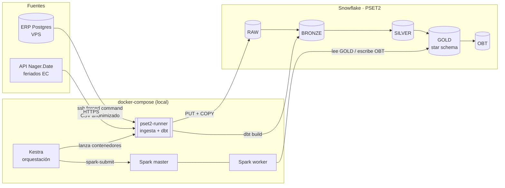

# PSet 2 · Pipeline ELT de ventas por hora

Pipeline reproducible que lleva las ventas del ERP de una tienda minorista hasta una
One Big Table (OBT). Esa tabla alimenta el pronóstico de ventas por hora del proyecto:
planificar horarios de personal en la matriz.

```
ERP (Postgres) ──SSH──┐
                      ├─ Kestra ─► RAW ─ dbt ─► BRONZE ─ dbt ─► SILVER ─ dbt ─► GOLD ─ Spark ─► OBT
API Nager.Date ───────┘            (Snowflake: base PSET2)
```



## Estructura

| Carpeta | Contenido |
|---|---|
| `docker-compose.yml` | Kestra (+ Postgres de metadatos) y Spark (master + worker) |
| `kestra/flows/` | `ingest_erp` (ingesta programada con retries y backfill) y `transform` (dbt → Spark) |
| `kestra/scripts/` | `extract_load.py` (extracción, contrato de columnas, carga y conciliación) y utilidades de secretos |
| `kestra/runner/` | Imagen `pset2-runner` que Kestra lanza para la ingesta y dbt (ssh + conector Snowflake + dbt-snowflake) |
| `kestra/server/` | Extractor de solo lectura instalado en el servidor del ERP (forced command de SSH) |
| `dbt/` | Proyecto dbt: Bronze/staging (`stg_*`), Silver (`int_*`), Gold (`dim_*`, `fct_*`), seeds y tests |
| `spark/` | `build_obt.py` (OBT + validaciones de joins) y la imagen `pset2-spark` (Spark 3.5.7 + spark-snowflake) |
| `docs/` | Setup de Snowflake, diagramas, perfilado de calidad (`calidad/`), capturas y documento técnico |

Además: `Makefile` (atajos), `.gitignore` y `secrets/` (vacía en el repo; las llaves solo existen en local).

## Requisitos

- Docker Desktop con al menos 6 GB de RAM asignados.
- Una cuenta de Snowflake. El trial sirve.
- Acceso SSH al servidor del ERP con la llave dedicada. Ver la sección «Instalar el extractor en el servidor».

## Puesta en marcha

1. **Credenciales.** Las credenciales viven solo en `.env` y `secrets/`, ambos fuera del repo.
   ```bash
   cp .env.example .env              # completar SNOWFLAKE_ACCOUNT, ERP_SSH_HOST y KESTRA_PASSWORD
   ssh-keygen -t ed25519 -N "" -C pset2-kestra-extract -f secrets/kestra_ssh_ed25519
   openssl genrsa 2048 | openssl pkcs8 -topk8 -nocrypt -out secrets/snowflake_rsa_key.p8
   openssl rsa -in secrets/snowflake_rsa_key.p8 -pubout -out secrets/snowflake_rsa_key.pub
   ```
2. **Snowflake.** Ejecuta `docs/snowflake_setup.sql` en Snowsight con ACCOUNTADMIN. Si generaste una llave nueva, reemplaza
   `RSA_PUBLIC_KEY` por el contenido de `secrets/snowflake_rsa_key.pub`, sin las líneas BEGIN/END.
   El script crea el warehouse XS con auto-suspend, la base `PSET2` con los esquemas
   `RAW/BRONZE/SILVER/GOLD/OBT`, un rol con permisos mínimos y un usuario de servicio sin contraseña.
3. **Levantar la infraestructura.**
   ```bash
   make secrets   # genera .env.kestra (secretos de Kestra en base64)
   make build     # construye pset2-runner y pset2-spark
   make up        # Kestra en http://localhost:8080 · Spark en http://localhost:8081
   make deploy    # valida y publica los flujos de kestra/flows
   ```
4. **Backfill histórico.** Una sola ejecución carga toda la ventana `ANALYSIS_START_DATE..ANALYSIS_END_DATE`:
   ```bash
   make backfill
   ```
   Al terminar en SUCCESS, el flujo `transform` se dispara solo y ejecuta `dbt build` y luego la OBT en Spark.
5. **Operación diaria.** El trigger `daily_after_close` corre a las 20:30 (America/Guayaquil), después del
   cierre de las 19:00, y recarga los últimos 7 días. Para forzar una corrida: `make ingest`. Para ver el estado: `make status`.
   Para probar los reintentos, ejecuta `ingest_erp` con `simulate_transient_failure = true`:
   el primer intento falla a propósito y el segundo debe cargar todo (estado final WARNING).

### Ejecutar cada pieza por separado

| Pieza | Comando |
|---|---|
| Ingesta | `make ingest`, o en Kestra: *pset2 › ingest_erp › Execute* |
| dbt (fuera de Kestra) | `make dbt-build` |
| dbt (dentro de Kestra) | `make transform` (ejecuta dbt y luego Spark) |
| Spark | Tarea `spark_obt` del flujo `transform`. El job está en `spark/build_obt.py` |

### Instalar el extractor en el servidor

```bash
scp kestra/server/pset2_extract.sh <usuario>@<host>:pset2/pset2_extract.sh
scp kestra/server/extract.env.example <usuario>@<host>:pset2/extract.env   # y completar los valores reales
# en ~/.ssh/authorized_keys del servidor, una línea:
command="/home/<usuario>/pset2/pset2_extract.sh",no-port-forwarding,no-X11-forwarding,no-agent-forwarding,no-pty <contenido de secrets/kestra_ssh_ed25519.pub>
```

Esa llave no puede abrir una shell. Solo ejecuta el extractor, que acepta una lista cerrada de
entidades, corre en una transacción de solo lectura y nunca exporta datos personales.

## Verificar resultados

En Snowsight, con el rol `PSET2_ROLE`:

```sql
select * from PSET2.RAW.LOAD_AUDIT order by loaded_at desc;   -- filas extraídas = cargadas
select * from PSET2.OBT.OBT_AUDIT;                           -- validaciones de la OBT
select count(*), sum(sales_count) from PSET2.OBT.OBT_SALES_HOURLY;
```

## Seguridad

- No hay contraseñas en el repositorio:
  - Snowflake usa par de llaves RSA para un usuario `TYPE = SERVICE`;
  - Kestra recibe los secretos por variables `SECRET_*`;
  - `.env`, `.env.kestra`, `.env.runtime` y `secrets/` están en `.gitignore`.
- Ningún dato se versiona. Los CSV extraídos solo existen en el contenedor efímero de la tarea.
